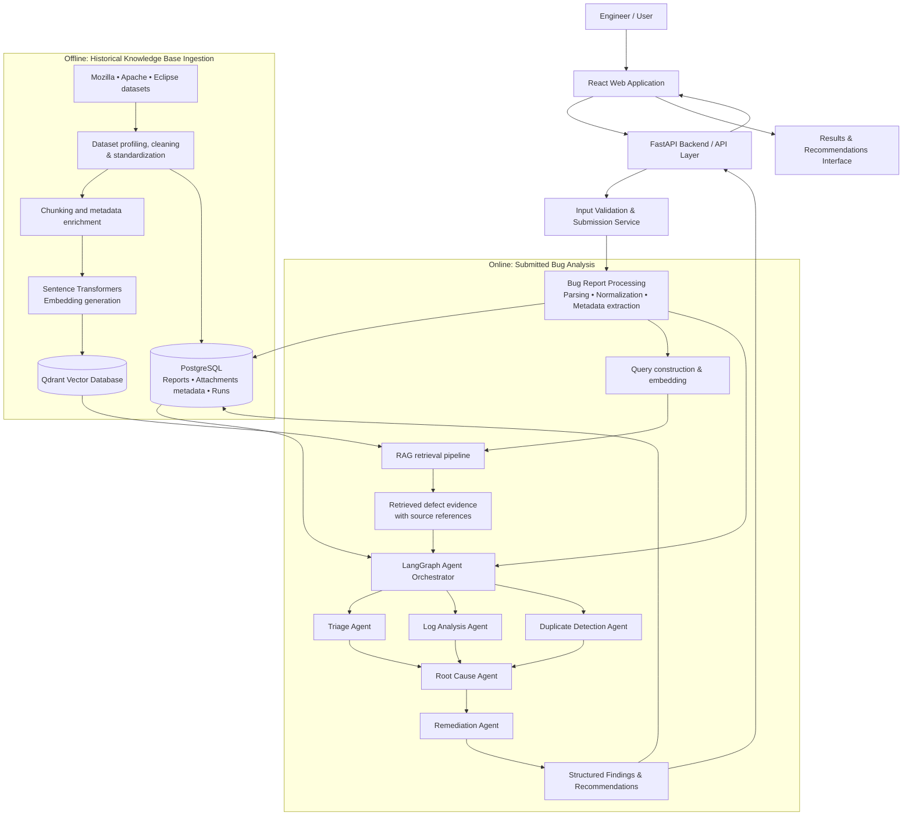
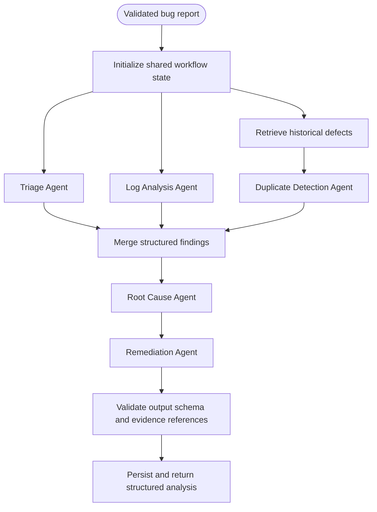

# Intelligent Software Defect Analysis System
### Infosys Springboard Internship — Milestone 1: Foundation & Bug Understanding

A proposed RAG-powered, multi-agent system for understanding software defect reports, retrieving relevant historical defects, and producing evidence-grounded diagnostic and remediation recommendations.

> **Milestone 1 submission scope:** This repository contains the system design, architecture, technology decisions, data contracts, research approach, and implementation plan. It is a design/foundation deliverable; components are identified as *proposed* unless explicitly marked implemented. Do not interpret the architecture as evidence that all runtime modules or agents have already been built.

## 1. Problem statement

Software defect reports frequently contain fragmented information: natural-language descriptions, stack traces, logs, environment details, reproduction steps, and discussion history. Engineers must interpret this evidence, search historical issues, identify likely causes, and determine a safe remediation path. This process can be time-consuming and inconsistent, particularly when relevant knowledge is distributed across multiple projects and issue trackers.

This project proposes an AI-assisted defect analysis workflow that combines:

- Structured bug-report intake and validation.
- A historical defect knowledge base seeded from public Mozilla, Apache, and Eclipse issue datasets.
- Retrieval-Augmented Generation (RAG) using semantic embeddings and vector search.
- Five specialized analysis agents coordinated through a stateful workflow.
- Structured findings with traceable references to retrieved historical defects.

The system is intended to support engineers, not autonomously modify source code or replace engineering review.

## 2. Milestone 1 objectives

1. Study defect-analysis workflows, RAG, semantic similarity, embeddings, vector search, and bug-report structures.
2. Define the system architecture, agent responsibilities, orchestration flow, and knowledge-base data model.
3. Design the bug-submission module for pasted text and supported file uploads.
4. Define the historical-defect ingestion pipeline: source analysis, cleaning, normalization, chunking, embedding generation, indexing, and retrieval evaluation.

## 3. Proposed technology stack

| Layer | Selected technology | Purpose |
|---|---|---|
| Web client | React.js + Vite | Bug submission, upload experience, and results interface |
| API/backend | Python + FastAPI | Validation, report processing, APIs, and service coordination |
| Relational storage | PostgreSQL | Submitted reports, attachments metadata, dataset metadata, and agent outputs |
| Vector database | Qdrant | Embedding storage, similarity search, and metadata filtering |
| Embedding model | Sentence Transformers (`all-MiniLM-L6-v2`) | Semantic representations of defect text |
| LLM | Google Gemini API | Contextual interpretation, reasoning, and structured natural-language findings |
| Agent orchestration | LangGraph | Stateful multi-agent workflow and controlled hand-offs |
| Data processing | Pandas, NumPy, Python | Dataset inspection, cleaning, normalization, and analysis |
| File parsing | PyMuPDF, `python-docx`, Python standard library | Extract text from supported documents and logs |
| API specification | OpenAPI / Swagger UI | API contract and interactive documentation |
| Testing | Pytest | Unit and integration tests |
| API verification | Postman | Endpoint and request/response verification |
| Version control | Git + GitHub | Source control and milestone documentation |
| Packaging | Docker | Reproducible local development and service packaging |

### Technology rationale

- **FastAPI** provides typed request/response contracts, validation through Pydantic, and generated OpenAPI documentation.
- **PostgreSQL** is appropriate for structured, transactional records and relationships between reports, attachments, and analysis runs.
- **Qdrant** provides vector similarity search with payload metadata filtering, which is useful for filtering by project, source, component, or defect type.
- **Sentence Transformers** separates embedding generation from LLM reasoning and enables repeatable indexing and retrieval experiments.
- **Gemini** is the proposed reasoning model for interpreting retrieved evidence and producing structured findings.
- **LangGraph** supports explicit workflow state, conditional routing, and observable agent transitions.
- **React + Vite** offers a lightweight frontend foundation without coupling UI concerns to the analysis pipeline.

The embedding model and LLM are separate components: embeddings support retrieval; the LLM supports contextual reasoning and generation.

## 4. System architecture

The system is organized into logical layers and modular services. This keeps the first milestone manageable while leaving clear extension points for later milestones.



### Architecture interpretation

- The **offline ingestion pipeline** prepares the historical knowledge base independently of user submissions.
- The **online analysis pipeline** validates an incoming report, retrieves relevant historical evidence, and supplies that evidence to the agent workflow.
- PostgreSQL stores structured records; Qdrant stores vectors and searchable metadata payloads.
- The orchestrator controls the agent sequence and shared workflow state.
- Findings should include evidence references and confidence/uncertainty indicators. A model-generated explanation must not be presented as a verified root cause without supporting evidence.

## 5. End-to-end data flow

### A. Historical knowledge-base ingestion (offline)

1. Acquire permitted public datasets or issue exports for Mozilla, Apache, and Eclipse.
2. Record dataset provenance, license/terms, source URL, retrieval date, and original issue identifier.
3. Profile schemas and map source-specific fields into a canonical defect schema.
4. Clean malformed records, normalize text, preserve technical tokens, and remove exact duplicates.
5. Split records into meaningful chunks (description, stack trace, comments, resolution).
6. Generate embeddings using the pinned embedding model and model version.
7. Upsert vectors and metadata into Qdrant; retain canonical records and provenance in PostgreSQL.
8. Run retrieval evaluation using a small, manually reviewed query set.

### B. Incoming bug analysis (online)

1. User pastes a report or uploads a supported file.
2. API validates file type, size, encoding, and required report fields.
3. Parser extracts text and normalizes the report while preserving original content.
4. Submission and attachment metadata are stored in PostgreSQL.
5. Query text is embedded and searched against Qdrant.
6. Relevant historical defect chunks are returned with source metadata and similarity scores.
7. LangGraph orchestrates specialized agents using the report, parsed logs, and retrieved evidence.
8. Results are validated against a structured output schema and stored.
9. The UI displays the classification, evidence, likely causes, duplicate candidates, and recommendations.

## 6. Agent design

| Agent | Primary responsibility | Inputs | Expected structured output |
|---|---|---|---|
| Triage Agent | Classify defect category, severity, and priority from report evidence | Title, description, environment, reproduction steps | `category`, `severity`, `priority`, `rationale` |
| Log Analysis Agent | Parse stack traces and logs; identify exceptions, error signatures, and suspicious locations | Raw logs, stack trace, environment | `error_signatures`, `suspected_locations`, `observations` |
| Duplicate Detection Agent | Compare the new report with retrieved historical defects and identify likely duplicates | Report text, retrieved candidates, similarity metadata | `candidate_defects`, `similarity`, `duplicate_assessment` |
| Root Cause Agent | Synthesize report, log findings, triage, and historical evidence into ranked hypotheses | Report, triage output, log findings, retrieved evidence | `root_cause_hypotheses`, `supporting_evidence`, `uncertainties` |
| Remediation Agent | Recommend investigation steps and potential corrective actions grounded in findings | Root-cause hypotheses, evidence, project context | `recommendations`, `validation_steps`, `risks` |

### Proposed orchestration



The design allows triage, log analysis, and retrieval to be parallelized where practical. Root-cause synthesis depends on their outputs. Remediation follows root-cause analysis. The exact execution graph can be refined after retrieval quality and agent interfaces are tested.

### Shared workflow state (proposed)

- `submission_id`
- `normalized_report`
- `parsed_logs`
- `triage_findings`
- `log_findings`
- `retrieved_defects`
- `duplicate_findings`
- `root_cause_hypotheses`
- `remediation_recommendations`
- `warnings`
- `execution_status`

Agents should return typed, schema-validated data rather than unstructured prose wherever possible.

## 7. Bug-report and knowledge-base data model

### Canonical bug report schema

| Field | Type | Description |
|---|---|---|
| `bug_id` | UUID | Internal submission identifier |
| `title` | string | Short defect summary |
| `description` | text | User-provided problem description |
| `steps_to_reproduce` | text / JSON array | Reproduction procedure |
| `expected_behavior` | text | Expected result |
| `actual_behavior` | text | Observed result |
| `stack_trace` | text, nullable | Stack trace if supplied |
| `logs` | text, nullable | Relevant logs |
| `environment` | JSON | OS, runtime, version, browser, etc. |
| `severity` | enum, nullable | Critical / High / Medium / Low / Unknown |
| `source_type` | enum | Pasted text / File upload |
| `created_at` | timestamp | Submission time |
| `status` | enum | Received / Processing / Completed / Failed |

### Historical defect schema

| Field | Type | Description |
|---|---|---|
| `defect_id` | string | Original source issue identifier |
| `source_project` | string | Mozilla / Apache / Eclipse project |
| `source_url` | string, nullable | Original issue URL |
| `title` | string | Original issue title |
| `description` | text | Normalized description |
| `comments` | text / JSON | Relevant discussion/comments |
| `resolution` | text, nullable | Fix or resolution details |
| `status` | string, nullable | Original issue status |
| `created_at` | timestamp, nullable | Source creation date |
| `updated_at` | timestamp, nullable | Source update date |
| `provenance` | JSON | Dataset name, version, license, import date |

### Chunk metadata

Each vector record should carry enough metadata to trace it to the original defect:

- `chunk_id`
- `defect_id`
- `source_project`
- `source_url`
- `chunk_type` (`description`, `stack_trace`, `comment`, `resolution`)
- `chunk_index`
- `embedding_model`
- `dataset_version`

## 8. RAG and retrieval strategy

### Chunking approach

Use structure-aware chunking rather than splitting every record at an arbitrary character count.

| Content type | Proposed strategy | Reason |
|---|---|---|
| Title + description | Keep together when short; otherwise split by paragraph | Preserve issue context |
| Stack trace | Preserve exception header and related frames; split long traces by frame groups | Avoid separating key error context |
| Comments | Chunk by individual comment or coherent discussion segment | Preserve conversational context |
| Resolution / fix | Keep resolution and associated explanation together | Retain cause-to-fix relationship |

Initial experimental settings (to be tuned using retrieval evaluation):

- Target chunk size: approximately 400–700 tokens.
- Overlap: approximately 50–100 tokens for long narrative chunks.
- Preserve source issue ID and chunk type in every record.
- Do not discard code symbols, exception names, file paths, version numbers, or error codes during cleaning.

These are starting parameters, not final measured optima.

### Retrieval flow

1. Construct a retrieval query from title, description, error signature, and relevant environment fields.
2. Generate the query embedding with the same embedding model used for indexing.
3. Search Qdrant using cosine similarity (after confirming the collection distance configuration).
4. Apply metadata filters where appropriate, such as project or chunk type.
5. Retrieve top-k candidates and group chunks by original defect ID.
6. Pass selected evidence and source identifiers to the agents.
7. Preserve similarity scores as retrieval signals, not as proof that two bugs are duplicates.

### Retrieval evaluation

Build a manually reviewed query set from held-out defects. Track:

- **Recall@K:** whether known relevant historical defects appear in the top K results.
- **Precision@K:** proportion of top K results judged relevant.
- **MRR:** rank of the first relevant result.
- **Duplicate detection quality:** precision, recall, and F1 against reviewed duplicate labels, where labels are available.
- **Evidence traceability:** percentage of generated claims linked to a retrieved source record.

Do not claim retrieval accuracy until evaluation has been run and results are recorded.

## 9. Bug submission module — proposed API contract

| Method | Endpoint | Purpose |
|---|---|---|
| `POST` | `/api/v1/bugs` | Submit pasted bug report as JSON |
| `POST` | `/api/v1/bugs/upload` | Upload supported bug report or log file |
| `GET` | `/api/v1/bugs/{bug_id}` | Retrieve submission details |
| `GET` | `/api/v1/bugs/{bug_id}/analysis` | Retrieve analysis result when available |
| `GET` | `/health` | Backend health check |

### Initial input validation

- Accept explicitly supported formats only (initially `.txt`, `.log`, `.md`, `.pdf`, `.docx`).
- Enforce configurable file-size limits.
- Validate extension and content type; do not trust filename alone.
- Handle invalid encodings and empty files safely.
- Store uploaded files outside the public web root and generate server-side filenames.
- Preserve original input and store normalized text separately.
- Treat uploaded content as untrusted data; do not execute scripts, binaries, or code found in reports.
- Keep secrets, API keys, and credentials out of logs and repository history.

The supported format list and limits should be finalized during implementation and documented in the API.

## 10. Dataset strategy and data governance

Candidate sources: public Mozilla, Apache, and Eclipse defect/issue datasets, including Kaggle-hosted copies where their provenance and terms can be verified.

Before ingestion:

1. Identify the original source and dataset publisher.
2. Verify the license and permitted use; a Kaggle mirror does not automatically grant rights beyond the original dataset terms.
3. Record dataset version, access date, source URL, and license.
4. Inspect schema differences and missing fields.
5. Keep original source identifiers for traceability.
6. Avoid including personal data or secrets from issue comments in the searchable corpus.
7. Document transformations so records can be reproduced or removed if required.

Do not commit large raw datasets to GitHub unless licensing and repository size make that appropriate. Prefer a documented download/preparation process and small synthetic samples for tests.

## 11. Non-functional requirements and risks

| Area | Design consideration |
|---|---|
| Reliability | Validate inputs and outputs; handle parser, database, and model API failures |
| Explainability | Link findings to retrieved defect IDs and relevant evidence |
| Security | File validation, safe storage, secret management, and input sanitization |
| Privacy | Minimize retained data and avoid logging sensitive report contents |
| Maintainability | Modular services, typed schemas, configuration-driven settings |
| Reproducibility | Pin dependencies and record model/dataset versions |
| Performance | Batch offline embedding generation; configure retrieval limits |
| Cost control | Use retrieval before LLM calls; bound context size and retries |

### Key risks and mitigations

- **Noisy or inconsistent datasets:** profile each source and normalize into a canonical schema.
- **Poor semantic matches:** evaluate chunking and embedding choices on a reviewed test set.
- **Hallucinated diagnoses:** require evidence references and expose uncertainty.
- **Large logs:** preserve error context while limiting input size and chunking long traces.
- **Model/API unavailability:** define timeouts, retry limits, and explicit failed-analysis states.
- **Dataset licensing ambiguity:** verify source terms before redistribution or use.

## 12. Milestone 1 work plan and acceptance criteria

| Work item | Deliverable / acceptance criteria |
|---|---|
| M1.1 Research | Research notes cover defect workflows, RAG, embeddings, semantic search, and source dataset structures |
| M1.2 Architecture | Architecture diagram, component responsibilities, orchestration flow, and canonical schemas documented |
| M1.3 Submission design | UI/API design supports pasted reports and planned file formats; validation and persistence requirements defined |
| M1.4 Knowledge base design | Dataset provenance, cleaning, chunking, embedding, Qdrant indexing, and retrieval evaluation approach documented |

### Suggested validation checklist

- [ ] Dataset fields from each source have been inspected and mapped.
- [ ] Canonical defect schema has been reviewed against actual source records.
- [ ] Supported upload formats and validation rules are documented.
- [ ] Architecture diagram agrees with the written data flow.
- [ ] Agent input/output contracts are defined.
- [ ] Embedding model and vector distance configuration are recorded.
- [ ] A small retrieval evaluation set and relevance labels are prepared.
- [ ] All implementation claims in the repository match the actual code state.

## 13. Repository structure

```text
ai-powered-software-defect-analysis/
├── README.md
├── .gitignore
├── docs/
│   ├── system-architecture.md
│   ├── system-architecture.mmd
│   ├── technology-stack.md
│   ├── agent-design.md
│   ├── database-schema.md
│   ├── research-and-technical-approach.md
│   ├── api-contract.md
│   └── milestone-1-plan.md
└── assets/
    └── README.md
```

## 14. Current status and next steps

This repository is the Milestone 1 architecture and technical-design baseline. The next implementation steps are to inspect and document the selected public datasets, establish the FastAPI and React project skeletons, implement report intake and persistence, then build and evaluate the historical-defect ingestion and retrieval pipeline.

**Design principle:** Every diagnosis should be evidence-aware, traceable to source defects where possible, and explicit about uncertainty. The system should assist engineering decisions rather than present unverified model output as fact.
