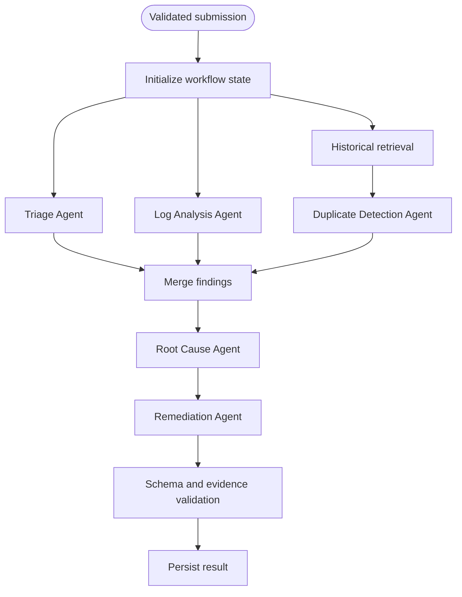

# Agent Design and Orchestration

## 1. Design principles

- Each agent has one clearly bounded responsibility.
- Agents receive only the context needed for their task.
- Outputs follow typed schemas and are validated.
- Retrieved historical defects are evidence, not guaranteed matches.
- The system separates observed facts, model inferences, and recommendations.
- Agent failures are captured as explicit workflow states.

## 2. Agent contracts

### Triage Agent
**Purpose:** Convert an unstructured report into a normalized defect classification.

Inputs: title, description, reproduction steps, actual/expected behavior, environment.

Outputs:
- category
- severity
- priority
- classification rationale
- missing information

### Log Analysis Agent
**Purpose:** Identify technical signals in stack traces and logs.

Inputs: stack trace, logs, runtime/environment metadata.

Outputs:
- exception/error signatures
- file paths and line references, when present
- likely failing component
- temporal or repeated patterns
- parsing warnings

### Duplicate Detection Agent
**Purpose:** Assess whether retrieved historical issues may describe the same underlying defect.

Inputs: normalized report and retrieved candidates with source IDs and similarity scores.

Outputs:
- ranked candidate issue IDs
- semantic similarity signals
- matching and conflicting details
- duplicate / possible duplicate / not enough evidence assessment

A vector similarity score alone must not determine duplicate status.

### Root Cause Agent
**Purpose:** Synthesize evidence into ranked, testable root-cause hypotheses.

Inputs: report, triage output, log findings, retrieved defects, duplicate assessment.

Outputs:
- ranked hypotheses
- evidence supporting each hypothesis
- contradictory or missing evidence
- confidence/uncertainty explanation
- suggested verification steps

### Remediation Agent
**Purpose:** Suggest safe, actionable next steps based on the preceding findings.

Inputs: root-cause hypotheses, evidence, relevant historical resolutions.

Outputs:
- recommended investigation/fix options
- rationale and evidence references
- validation and regression test suggestions
- risks and assumptions

## 3. Orchestration graph

Triage, log analysis, and retrieval can be parallel branches after input normalization. Duplicate detection depends on retrieval candidates. Root-cause synthesis waits for upstream outputs. Remediation follows root-cause synthesis.

## 4. Shared workflow state

| Key | Type (conceptual) | Owner / producer |
|---|---|---|
| `submission_id` | UUID string | API |
| `normalized_report` | object | Processing service |
| `parsed_logs` | object | Log parser |
| `retrieved_defects` | list of evidence objects | RAG service |
| `triage_findings` | object | Triage Agent |
| `log_findings` | object | Log Analysis Agent |
| `duplicate_findings` | object | Duplicate Detection Agent |
| `root_cause_hypotheses` | list | Root Cause Agent |
| `remediation_recommendations` | list | Remediation Agent |
| `warnings` | list of strings | Any stage |
| `execution_status` | enum | Orchestrator |

## 5. Output quality controls

- Validate required fields and enumerated values.
- Require evidence references for claims based on historical defects.
- Do not fabricate issue IDs, file paths, line numbers, or resolutions.
- Use explicit `unknown` / `insufficient_evidence` states.
- Keep prompt templates versioned.
- Capture per-agent status, duration, and bounded error information without logging secrets or full sensitive inputs.
